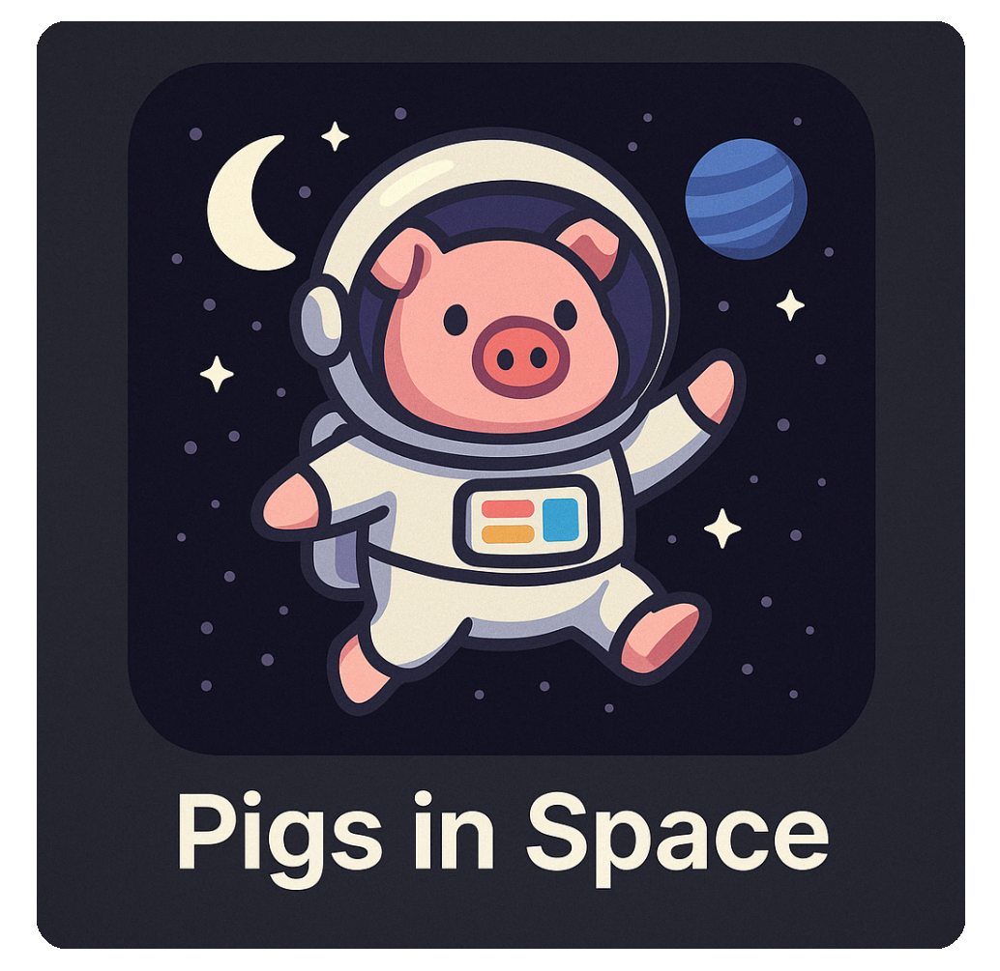

# Pigs in Space

Primordial Prometheus theme engineers have fused the aesthetic DNA of Solarized and Twilight, 
creating Pigs in Space—a theme purpose-built for epic coding expeditions.
Darker than Event Horizon yet brighter than The Fifth Element, it offers visual harmony, 
balanced contrast, and interstellar readability, ensuring comfort as you journey
through even the most mysterious corners of your codebase. 

With Pigs in Space, no one will hear you scream—because a thoughtfully designed palette and 
exceptional clarity transform your IDE into the ultimate deep-flow coding environment.

## Installation

1. In your JetBrains IDE, go to **Settings/Preferences** → **Plugins**
2. Click on the **Marketplace** tab
3. Search for "Pigs in Space"
4. Click **Install**
5. Restart your IDE when prompted
6. Go to **Settings/Preferences** → **Appearance & Behavior** → **Appearance**
7. Select "Pigs in Space" from the Theme dropdown

## Screenshots

